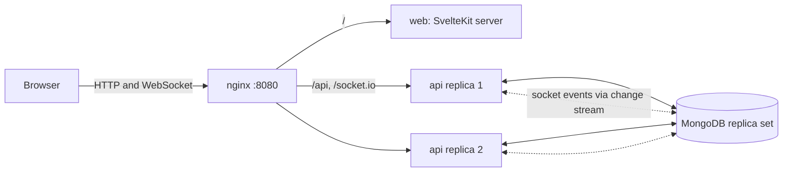
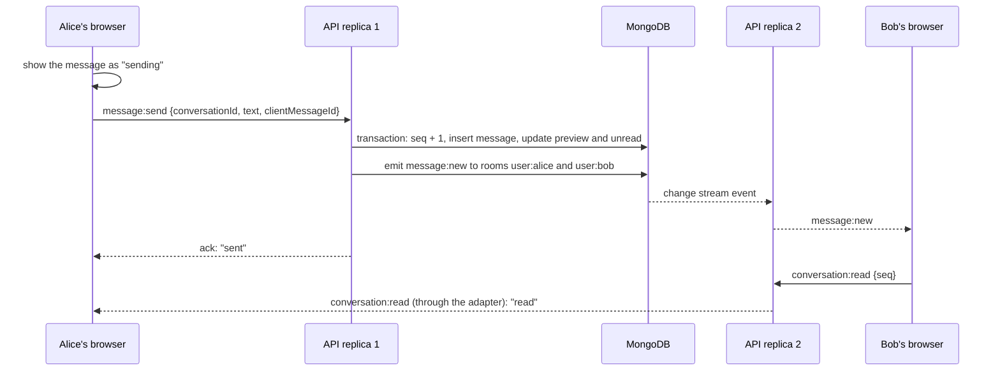

# Realtime Chat

One-to-one web chat with real-time delivery and 15-second video stories. NestJS and MongoDB on the
back end, SvelteKit (Svelte 5) on the front end, Socket.io in between. The whole stack, two API
replicas included, starts with one command.

## Quick start

Requires Docker with Compose v2.

```bash
docker compose up --build
```

When all services are healthy, open <http://localhost:8080>. Demo accounts, in another terminal:

```bash
docker compose exec api node dist/seed.js
```

| User  | Email             | Password     |
| ----- | ----------------- | ------------ |
| alice | alice@example.com | Password123! |
| bob   | bob@example.com   | Password123! |
| carol | carol@example.com | Password123! |
| dave  | dave@example.com  | Password123! |

Sign in as alice and as bob in two separate browser windows (one of them private). Registration
works too. The camera needs `localhost` or HTTPS, so record stories at `http://localhost:8080`.

Stop with `docker compose down`, add `-v` to delete the data.

## What to try

1. Send messages both ways: delivery, the typing indicator, read receipts, unread counters.
2. Stop the API with `docker compose stop api`: a connection banner appears and a message sent
   now is marked "Not delivered". Run `docker compose start api`: the client reconnects, sends it
   and fetches whatever it missed.
3. Stop one replica with `docker stop realtime-chat-api-1`: the chat keeps working through the
   other one. `docker compose logs api | grep "Socket connected"` shows which replica holds whom.
4. Record a story: it stops by itself at 15 seconds and appears in the other window right away.
5. API reference at <http://localhost:8080/api/docs>.

## What is implemented

From the brief: sign-up and sign-in with JWT, protected routes, user list and search by username,
one-to-one conversations with real-time delivery, stories (webcam recording up to 15 s, a feed of
users with live stories, removal after 24 hours), Docker Compose, tests.

On top of it:

- read receipts, typing indicator, online status, unread counters;
- optimistic sending; a retry never duplicates a message, and whatever was missed during a drop is
  fetched after reconnecting;
- two API replicas behind nginx that exchange socket events through MongoDB;
- rotating refresh tokens with reuse detection;
- one typed contract (zod schemas, DTO types, socket events) shared by the API and the web app.

Not built, as the brief rules them out: group chats, files in chat, editing or deleting messages,
video effects or processing, push notifications, deployment.

## Architecture



- **nginx** serves everything from one origin, so the refresh cookie and the socket need no CORS.
  It balances sockets across replicas without sticky sessions and holds the shared sign-in limit.
- **api** (NestJS): `auth`, `users`, `conversations`, `messages`, `chat` (socket gateway),
  `stories`, `storage`, `realtime`, `health`.
- **MongoDB** holds the data, story videos (GridFS) and the capped collection that carries socket
  events between replicas.
- **web** (SvelteKit, adapter-node) renders the sign-in pages on the server; the signed-in app runs
  in the browser, where the access token lives.

### The path of one message



## Design decisions

**One contract.** `packages/shared` holds zod schemas for requests and responses, socket event types
and limits. The API validates bodies and socket payloads with them, the web forms use the same
rules, and Swagger is generated from them.

**Messages.** Storing a message, bumping the conversation's `seq`, updating the preview and the
unread counters is one transaction. `seq` gives a strict order per conversation (object ids from two
replicas are not ordered within a second), the history cursor and the catch-up query. Sends from one
socket are processed in arrival order. The client generates a `clientMessageId`; a unique index on
`(senderId, clientMessageId)` means a retry stores nothing new: it returns the stored message and
delivers it again, so a message whose ack was lost still reaches the recipient, and clients drop
the duplicate.

**Delivery after a drop.** The client closes the socket as soon as the browser reports it is
offline and reconnects as soon as it is back. After a reconnect it reloads the conversation list,
fetches every message after the last one it holds without a gap, page by page, and resends
unconfirmed messages one at a time with their original ids. A jump in `seq` on a live message
triggers the same catch-up.

**Sessions.** Access tokens are 15-minute JWTs kept in memory. The refresh token is an httpOnly,
`SameSite=Strict` cookie scoped to `/api/auth`, stored only as a SHA-256 hash and rotated on every
use; replaying a rotated token revokes the whole session, except within 10 seconds, which is a race
between the user's own tabs (a Web Lock also serializes refreshes across tabs). A socket is closed
when its token expires, and the client reconnects with a fresh one; signing out or revoking a
session closes its sockets on every replica. Passwords are hashed with argon2id; a wrong password and an unknown email get the same
answer in the same time.

**Scaling.** `@socket.io/mongo-adapter` writes broadcasts into a capped collection that every replica
tails through a change stream (cursor tailing over the oplog, with resume tokens). MongoDB is
already in the stack, so no Redis. Each socket joins `user:<id>`, so one emit reaches every tab and
device of a user. The client uses the WebSocket transport only: sticky sessions are not needed, and
the cost is no long-polling fallback for networks that block WebSockets.

**Presence.** An instance answers for its own sockets and asks the others; one that does not answer
within 2 seconds counts as having none, so a crashed replica does not stall the query. "Offline" is
announced only after a user's last socket has been gone for 2 seconds, so a reload does not flicker.
A crashed replica announces nothing, so clients also re-check their peers every 30 seconds.

**Stories.** Uploads are `multipart/form-data`, up to 25 MB, WebM or MP4 by file signature (Safari
records MP4). The recorder stops itself at 15 seconds; the server checks the declared duration and the
size but does not probe the video, since the brief rules out video processing. Videos live in GridFS
behind a `VideoStorage` interface (S3 would be a second implementation) and stream with HTTP Range
support. `<video>` cannot send an Authorization header, so the client asks for a short-lived signed
link when a story is opened. A new story travels in the socket event itself: clients add it to
their feed without a request, so one upload does not make everyone reload the feed. A TTL index removes expired story documents but not GridFS files, so a
job on every replica deletes the files, idempotently; every query also filters on expiry. Chrome
writes WebM without a duration, so the client writes it into the file before upload.

**Front end.** Application state lives in Svelte stores (`auth`, `conversations`, `messages`,
`presence`, `typing`, `stories`, connection status); components use runes for local state.

**Known limits.** If a replica dies between committing a message and broadcasting it, the recipient
sees it with the next message or a reload, through the `seq` gap (an outbox would close this). The
per-socket rate limit counts per replica (nginx holds the shared sign-in limit). Story duration is
checked as declared. The Compose file ships a demo JWT secret and
`COOKIE_SECURE=false` for `http://localhost`; set both for anything real.

## Tests

```bash
pnpm install
pnpm test
```

- **API** (Vitest, supertest, socket.io-client) against an in-memory MongoDB replica set, so
  transactions and change streams are real: auth and token rotation, search, conversation creation
  under 20 concurrent requests, gapless `seq` and sender order under concurrent sends, idempotent
  retries, access control, socket handshake and acks, presence, rate limits, story uploads, Range,
  expiry and file cleanup. One test file runs two API instances on one database and checks that
  everything crosses between them, including presence while a third instance hangs.
- **Web** (Vitest): the stores and utilities.
- **End to end** (Playwright, Chromium and Firefox, fake camera) against the Compose stack: two
  browsers chatting live, dropped connections, reloads, a story recorded until it stops itself and
  shown to another user, widths from 320 to 1920 px.

```bash
docker compose up -d --build --wait
pnpm --filter @chat/web exec playwright install chromium firefox
pnpm test:e2e
```

The end-to-end suite registers new users on every run, so more than about three runs in a row hit
the sign-in rate limit (30 per minute per address).

## Local development

Requires Node.js 22.17+, pnpm 10 and Docker (for MongoDB only).

```bash
pnpm install
cp .env.example .env
pnpm db:up
pnpm dev
```

`pnpm db:up` starts MongoDB as its own Compose project with the port published on `127.0.0.1`
(`pnpm db:down` stops it). The web app runs at <http://localhost:5173> and proxies `/api` and
`/socket.io` to the API on port 3000. `pnpm seed` adds the demo users.

| Command          | What it does                                 |
| ---------------- | -------------------------------------------- |
| `pnpm dev`       | shared package, API and web in watch mode    |
| `pnpm lint`      | ESLint and Prettier                          |
| `pnpm typecheck` | `tsc` and `svelte-check`                     |
| `pnpm test`      | unit and integration tests                   |
| `pnpm build`     | production builds                            |
| `pnpm test:e2e`  | Playwright against the running Compose stack |

## API

OpenAPI: <http://localhost:8080/api/docs> (JSON at `/api/docs-json`). Errors always look like
`{ statusCode, error, message, details?, requestId }`, including the ones nginx produces for `/api`.

| Method | Path                                    | Purpose                                                      |
| ------ | --------------------------------------- | ------------------------------------------------------------ |
| POST   | `/api/auth/register`                    | create an account and sign in                                |
| POST   | `/api/auth/login`                       | sign in                                                      |
| POST   | `/api/auth/refresh`                     | new access token from the refresh cookie                     |
| POST   | `/api/auth/logout`                      | sign out                                                     |
| GET    | `/api/auth/me`                          | current user                                                 |
| GET    | `/api/users?q=&cursor=&limit=`          | users, prefix search by username                             |
| GET    | `/api/conversations?cursor=`            | my conversations, latest activity first                      |
| POST   | `/api/conversations`                    | open (or create) a conversation with a user                  |
| GET    | `/api/conversations/:id`                | one conversation                                             |
| GET    | `/api/conversations/:id/messages`       | history; `before=<seq>` pages back, `after=<seq>` catches up |
| POST   | `/api/conversations/:id/messages`       | send over REST (same service as the socket)                  |
| POST   | `/api/conversations/:id/read`           | mark as read up to `seq`                                     |
| POST   | `/api/stories`                          | upload a story (multipart: `video`, `durationMs`)            |
| GET    | `/api/stories/feed`                     | users with live stories                                      |
| GET    | `/api/stories/:id/playback`             | signed video link for one story                              |
| GET    | `/api/stories/:id/video?token=`         | stream the video (Range supported)                           |
| POST   | `/api/stories/:id/view`                 | mark a story as seen                                         |
| DELETE | `/api/stories/:id`                      | delete my story                                              |
| GET    | `/api/health/live`, `/api/health/ready` | liveness, readiness (pings MongoDB)                          |

Socket.io at `/socket.io` with `auth: { token }`; a rejected handshake carries `data.code`:
`TOKEN_EXPIRED`, `UNAUTHORIZED` or `UNAVAILABLE` (try again).

| Direction       | Event               | Payload                                                           |
| --------------- | ------------------- | ----------------------------------------------------------------- |
| client → server | `message:send`      | `{ conversationId, text, clientMessageId }`, ack with the message |
| client → server | `conversation:read` | `{ conversationId, seq }`, ack                                    |
| client → server | `typing`            | `{ conversationId, isTyping }`                                    |
| client → server | `presence:query`    | `{ userIds }`, ack with `{ [userId]: online }`                    |
| server → client | `message:new`       | `{ message, conversation }`                                       |
| server → client | `conversation:read` | `{ conversationId, userId, seq }`                                 |
| server → client | `typing`            | `{ conversationId, userId, isTyping }`                            |
| server → client | `presence`          | `{ userId, online }`                                              |
| server → client | `story:created`     | `{ story, author }`                                               |
| server → client | `story:deleted`     | `{ storyId, authorId }`                                           |

## Configuration

Docker Compose reads these from a `.env` file next to `docker-compose.yml` (see `.env.example`):

| Variable                     | Default    | Meaning                                    |
| ---------------------------- | ---------- | ------------------------------------------ |
| `APP_PORT`                   | `8080`     | port nginx listens on                      |
| `MONGO_PORT`                 | `27017`    | MongoDB port on 127.0.0.1 for `pnpm db:up` |
| `JWT_SECRET`                 | demo value | signing key, 32+ characters                |
| `COOKIE_SECURE`              | `false`    | `true` whenever served over HTTPS          |
| `AUTH_RATE_LIMIT_PER_MINUTE` | `30`       | sign-in attempts per address per replica   |
| `LOG_LEVEL`                  | `info`     | pino log level                             |

The API also reads `MONGO_URI`, `PORT`, `NODE_ENV`, `ACCESS_TOKEN_TTL_SECONDS` (900),
`REFRESH_TOKEN_TTL_DAYS` (30), `MEDIA_TOKEN_TTL_SECONDS` (3600), `CORS_ORIGINS` and `TRUST_PROXY`,
and refuses to start with a missing or invalid value, naming it.

## Project structure

```
apps/
  api/            NestJS API: src/ by module, test/ integration, socket and two-instance tests
  web/            SvelteKit app: src/lib (stores, socket client, components), src/routes, e2e/
packages/
  shared/         zod schemas, socket events, limits
infra/nginx/      reverse proxy
docker-compose.yml       the whole stack
docker-compose.dev.yml   MongoDB port for local development
```

## Toward production

- S3 as a second `VideoStorage`, direct uploads by presigned URL, a CDN in front of the videos, a
  worker that checks the real duration.
- Kubernetes: Deployments for `api` and `web` with the existing readiness and liveness probes, an
  Ingress with WebSocket support (no session affinity needed), MongoDB Atlas or an operator-managed
  replica set, secrets from the cluster.
- Redis for the shared rate limit and presence once there are many replicas; the Redis adapter at
  higher fan-out.
- HTTPS with `COOKIE_SECURE=true`, metrics and tracing (OpenTelemetry), log shipping.
