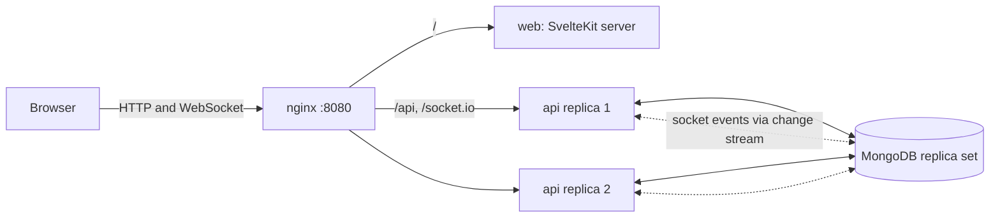
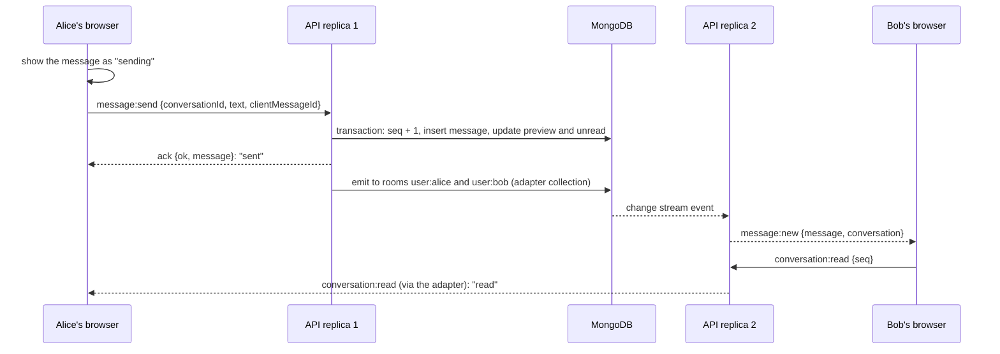

# Realtime Chat

One-to-one web chat with real-time delivery and 15-second video stories.
NestJS 12 and MongoDB on the back end, SvelteKit 3 (Svelte 5) on the front end, Socket.io in
between. The whole stack, two API replicas included, starts with one Docker Compose command.

## What it does

The brief:

- Sign up with email, username and password; sign in with JWT; private routes are protected.
- List and search users by username, start a conversation with anyone.
- Conversation list, text messages, delivery in real time over WebSocket.
- Stories: record up to 15 seconds from the webcam, a feed of users with live stories,
  automatic removal after 24 hours.

Beyond it:

- Read receipts, typing indicator, online status, unread counters.
- Optimistic sending with retry; nothing is lost or duplicated when the connection drops.
- Horizontal scaling: two API replicas behind nginx exchange socket events through MongoDB.
- Rotating refresh tokens with reuse detection.
- One typed contract (zod schemas, DTO types, socket events) shared by the API and the web app.
- Unit, integration, socket, multi-instance and browser end-to-end tests; CI on GitHub Actions.

## Quick start

Requires Docker with Compose v2.

```bash
docker compose up --build
```

When all services report healthy, open <http://localhost:8080>. To get demo accounts, run in
another terminal:

```bash
docker compose exec api node dist/seed.js
```

| User  | Email             | Password     |
| ----- | ----------------- | ------------ |
| alice | alice@example.com | Password123! |
| bob   | bob@example.com   | Password123! |
| carol | carol@example.com | Password123! |
| dave  | dave@example.com  | Password123! |

Sign in as alice in one browser and as bob in another (or in a private window) to chat. The
seed is idempotent and can be run again. Registration works as well.

The camera works only on `localhost` or over HTTPS, so record stories at
`http://localhost:8080`, not via a LAN address.

Stop with `docker compose down` (add `-v` to delete the data). Ports and the JWT secret can be
changed in a `.env` file next to `docker-compose.yml`, see [Configuration](#configuration).

## Local development

Requires Node.js 22.17+, pnpm 10 and Docker (for MongoDB only).

```bash
pnpm install
cp .env.example .env
pnpm db:up
pnpm dev
```

`pnpm db:up` starts MongoDB from the Compose file with its port published on `127.0.0.1`
(`docker-compose.dev.yml`; the quick start does not publish it, so a local mongod on 27017 does
not get in its way). The web app runs at <http://localhost:5173>, the API at port 3000. Vite
proxies `/api` and `/socket.io` to the API, so the browser sees one origin, as it does behind
nginx. With `pnpm dev` running, `pnpm seed` adds the demo users.

| Command          | What it does                                                 |
| ---------------- | ------------------------------------------------------------ |
| `pnpm db:up`     | MongoDB for local development, port published on 127.0.0.1   |
| `pnpm dev`       | shared package, API and web in watch mode                    |
| `pnpm lint`      | ESLint and Prettier check                                    |
| `pnpm typecheck` | `tsc` for the API and shared package, `svelte-check` for web |
| `pnpm test`      | unit and integration tests of all packages                   |
| `pnpm build`     | production builds                                            |
| `pnpm test:e2e`  | Playwright against the running Compose stack                 |

## Tests

```bash
pnpm test
```

- **API** (Vitest, supertest, socket.io-client) runs against an in-memory MongoDB replica set,
  so transactions and change streams are real. Covered: registration and login, token rotation
  and reuse detection, users and search (including regex injection), conversation creation
  under 20 concurrent requests, gapless message sequence under concurrent sends, idempotent
  retries, access control, read state, socket handshake, acks, delivery to every tab, typing,
  presence, rate limits, story upload checks, HTTP Range, expiry and file cleanup.
- **Two instances**: one test file starts two API instances on one database and checks that
  messages, receipts, typing, presence and story announcements cross between them, and that
  presence stays right while a third node is still counted by the others but no longer answers,
  as a crashed instance is in its first seconds.
- **Web** (Vitest): the stores (optimistic sending, retries, ordering, catch-up, unread and read
  state, auth refresh deduplication) and utilities.
- **End to end** (Playwright, Chromium and Firefox with fake cameras) against the Compose stack:
  sign-up and route guards, two browsers chatting live, typing and read receipts, a second tab,
  recovery from a dropped connection, history paging, and a story recorded until it stops itself
  at 15 seconds and shows up for another user. Every main screen is also checked at widths from
  320 to 1920 px for horizontal scrolling and for controls staying in view.

```bash
docker compose up -d --build --wait
pnpm --filter @chat/web exec playwright install chromium firefox
pnpm test:e2e
```

The end-to-end suite registers fresh users on every run and goes through the sign-in rate limit
(30 per minute per address), so running it many times in a row will hit 429 responses.

## Architecture



- **nginx** serves everything from one origin: the refresh cookie and the socket need no CORS.
  It balances Socket.io connections across replicas (websocket transport only, so no sticky
  sessions) and applies the sign-in rate limit shared by both replicas.
- **API** (NestJS) modules: `auth`, `users`, `conversations`, `messages`, `chat` (the socket
  gateway), `stories`, `storage`, `realtime`, `health`.
- **MongoDB** holds users, sessions, conversations, messages, stories (videos in GridFS) and the
  capped collection that carries socket events between replicas.
- **web** (SvelteKit with adapter-node) renders the sign-in pages on the server; the signed-in
  app runs in the browser, where the access token lives.

### The path of one message



## Decisions and trade-offs

**Shared contract.** `packages/shared` holds zod schemas, DTO types, socket event maps and
limits. The API validates request bodies and socket payloads with these schemas through Nest's
Standard Schema pipe, the web forms validate with the same ones, and Swagger is generated from
them. A field rule lives in one place.

**Sessions.** Access tokens are short JWTs (15 minutes) kept in memory, never in storage. The
refresh token is an httpOnly, `SameSite=Strict` cookie scoped to `/api/auth`; only its SHA-256
hash is stored. Every refresh rotates it, and replaying an already rotated token revokes the
whole session family. A rotated token seen again within 10 seconds is treated as a race of the
user's own requests rather than theft; on the client a Web Lock serializes refreshes across tabs.
A non-secret `sid` cookie tells the SvelteKit server to redirect guests early and tells the
client whether a session is worth restoring. Passwords are hashed with argon2id; a wrong
password and an unknown email get the same answer in the same time.

**Messages.** Storing a message, bumping the conversation's `seq`, updating the preview and the
unread counters happen in one transaction. `seq` gives a strict order per conversation (object
ids from two replicas are not ordered within a second), the history cursor, and the catch-up
query after a reconnect. The client sends a `clientMessageId`; a unique index on
`(senderId, clientMessageId)` turns a retry into a no-op that returns the stored message.
Replying marks the conversation as read for the sender.

**Conversations.** A unique `pairKey` (two sorted user ids) makes creation idempotent: when two
people open the conversation at the same moment, one insert wins and the other request returns
that conversation. A conversation without messages is visible only to the user who opened it.

**Real time.** Each socket joins `user:<id>`, so one emit reaches all tabs and devices of a
user. Errors come back through the ack in the same format as REST errors. Presence asks every
instance which of the users have sockets there, so several tabs and several instances count
correctly. An instance that does not answer within 2 seconds counts as having none: after a
crash the others wait for it until its heartbeats are 5 seconds overdue, and by then its users
have reconnected elsewhere. "Offline" is announced by the instance the last socket left, and
only if no socket comes back within 2 seconds, so a page reload does not flicker. A crashed
instance announces nothing, so clients also re-check their peers every 30 seconds. Socket
events are rate-limited per socket.

**Scaling.** `@socket.io/mongo-adapter` writes broadcasts into a capped collection and every
replica reads them with a change stream, which is cursor tailing over the oplog with resume
tokens. MongoDB is already there, so no Redis is needed; a capped collection bounds the size
without a TTL sweep. The client uses the WebSocket transport only: sticky sessions by IP would put
all local clients on one replica, and the cost is losing the long-polling fallback for networks
that block WebSockets.

**Stories.** Uploads are `multipart/form-data`, up to 25 MB, and must be WebM or MP4 by file
signature, whatever MIME type the client claims (Safari records MP4). The recorder stops itself
at 15 seconds; the server checks the declared duration and the size but does not probe the video,
since the brief rules out video processing on the server (a probing worker would be the next
step). Videos live in GridFS, which works with any number of replicas and no shared disk, behind
a `VideoStorage` interface that an S3 implementation could replace. They stream with HTTP Range
support (Safari will not play without it), authorized by a short-lived signed URL because a
`<video>` element cannot send an Authorization header. A TTL index removes expired story
documents, but not GridFS files, so a job on every replica deletes files by their own expiry,
idempotently; all queries also filter on expiry, so nothing is served in between. Chrome writes
WebM without a duration, so the client writes it into the file before upload, and the player
draws progress from the recorded duration.

**Front end.** Application state lives in Svelte stores (`auth`, `conversations`, `messages`,
`presence`, `typing`, `stories`, connection status), components use runes. Messages are shown
right away and confirmed by the ack; failed ones can be retried with the same id, and transient
failures are retried after reconnecting. After a reconnect the app reloads the conversation list
and fetches missed messages by `seq`. Reconnection is immediate when the browser comes back
online or the tab becomes visible.

**Known limits.** The per-instance rate limiter counts per replica (nginx holds the shared
limit). The Compose file ships a demo JWT secret and `COOKIE_SECURE=false` for
`http://localhost`; both must be set for anything real. Story duration is checked as declared.

## API

OpenAPI documentation: <http://localhost:8080/api/docs> (JSON at `/api/docs-json`).

| Method | Path                                    | Purpose                                                      |
| ------ | --------------------------------------- | ------------------------------------------------------------ |
| POST   | `/api/auth/register`                    | create an account and sign in                                |
| POST   | `/api/auth/login`                       | sign in                                                      |
| POST   | `/api/auth/refresh`                     | new access token from the refresh cookie                     |
| POST   | `/api/auth/logout`                      | revoke the session                                           |
| GET    | `/api/auth/me`                          | current user                                                 |
| GET    | `/api/users?q=&cursor=&limit=`          | users, prefix search by username                             |
| GET    | `/api/conversations?cursor=`            | my conversations, latest activity first                      |
| POST   | `/api/conversations`                    | open (or create) a conversation with a user                  |
| GET    | `/api/conversations/:id/messages`       | history; `before=<seq>` pages back, `after=<seq>` catches up |
| POST   | `/api/conversations/:id/messages`       | send over REST (same service as the socket)                  |
| POST   | `/api/conversations/:id/read`           | mark as read up to `seq`                                     |
| POST   | `/api/stories`                          | upload a story (multipart: `video`, `durationMs`)            |
| GET    | `/api/stories/feed`                     | users with live stories                                      |
| GET    | `/api/stories/:id/video?token=`         | stream a story video (Range supported)                       |
| POST   | `/api/stories/:id/view`                 | mark a story as seen                                         |
| DELETE | `/api/stories/:id`                      | delete my story                                              |
| GET    | `/api/health/live`, `/api/health/ready` | liveness, readiness (pings MongoDB)                          |

Errors always look like `{ statusCode, error, message, details?, requestId }`.

Socket.io (path `/socket.io`, `auth: { token }` in the handshake; a rejected handshake carries
`data.code` of `TOKEN_EXPIRED` or `UNAUTHORIZED`):

| Direction       | Event                            | Payload                                                           |
| --------------- | -------------------------------- | ----------------------------------------------------------------- |
| client → server | `message:send`                   | `{ conversationId, text, clientMessageId }`, ack with the message |
| client → server | `conversation:read`              | `{ conversationId, seq }`, ack                                    |
| client → server | `typing`                         | `{ conversationId, isTyping }`                                    |
| client → server | `presence:query`                 | `{ userIds }`, ack with `{ [userId]: online }`                    |
| server → client | `message:new`                    | `{ message, conversation }`                                       |
| server → client | `conversation:read`              | `{ conversationId, userId, seq }`                                 |
| server → client | `typing`                         | `{ conversationId, userId, isTyping }`                            |
| server → client | `presence`                       | `{ userId, online }`                                              |
| server → client | `story:created`, `story:deleted` | `{ storyId, authorId }`                                           |

## Configuration

Docker Compose reads these from `.env` (see `.env.example`):

| Variable                     | Default    | Meaning                                    |
| ---------------------------- | ---------- | ------------------------------------------ |
| `APP_PORT`                   | `8080`     | port nginx listens on                      |
| `MONGO_PORT`                 | `27017`    | MongoDB port on 127.0.0.1 for `pnpm db:up` |
| `JWT_SECRET`                 | demo value | signing key, 32+ characters                |
| `COOKIE_SECURE`              | `false`    | `true` whenever served over HTTPS          |
| `AUTH_RATE_LIMIT_PER_MINUTE` | `30`       | sign-in attempts per address per replica   |
| `LOG_LEVEL`                  | `info`     | pino log level                             |

The API also reads `MONGO_URI`, `PORT`, `NODE_ENV`, `ACCESS_TOKEN_TTL_SECONDS` (900),
`REFRESH_TOKEN_TTL_DAYS` (30), `MEDIA_TOKEN_TTL_SECONDS` (3600), `CORS_ORIGINS` (comma
separated, empty by default since everything is same-origin) and `TRUST_PROXY`. It refuses to
start with a missing or invalid value and says which one.

## Project structure

```
apps/
  api/            NestJS API
    src/          auth, users, conversations, messages, chat, stories, storage, realtime, ...
    test/         integration, socket and two-instance tests
  web/            SvelteKit app
    src/lib/      stores, socket client, API client, stories recorder, components
    src/routes/   (guest) sign-in pages, (app) chats, people, stories
    e2e/          Playwright tests
packages/
  shared/         zod schemas, DTO types, socket events, limits
infra/
  nginx/          reverse proxy configuration
docker-compose.yml
```

## Toward production

- Object storage (S3 or compatible) as a second `VideoStorage` implementation; a worker that
  probes uploaded videos for their real duration.
- Kubernetes: Deployments for `api` (N replicas, readiness `/api/health/ready`, liveness
  `/api/health/live`) and `web`, an Ingress with WebSocket support (no session affinity needed),
  MongoDB Atlas or an operator-managed replica set, secrets from the cluster's secret store.
- A shared store for rate limiting (Redis or MongoDB) once there are more replicas than nginx
  instances; at higher fan-out, the Redis adapter instead of the MongoDB one.
- HTTPS with `COOKIE_SECURE=true`, tracing and metrics (OpenTelemetry), log shipping.
